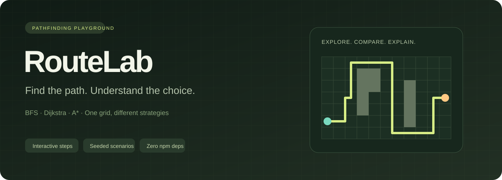

# RouteLab



**A shorter route is not always a cheaper route.** RouteLab makes that trade-off visible: paint a weighted grid, run BFS, Dijkstra or A*, replay their explored cells, and compare the actual results on the same terrain.

Dependency-free JavaScript · Canvas · deterministic scenarios · Node.js test runner · MIT

## Run in 30 seconds

Install **Node.js 24 or newer**, then run from this directory:

```sh
node server.mjs
```

Open **http://127.0.0.1:4313**. No installation command, account, API key or internet connection is required after Node is installed. `npm start` is an optional equivalent if npm is available. The server binds only to your own computer. Set the `PORT` environment variable to change its port.

```sh
node --test
```

This runs the algorithm, editor history, persistence and HTTP server tests. GitHub Actions runs the same command on Windows and Ubuntu with Node 24. CI configuration is provided; a green hosted run is not implied until GitHub runs it.

## Try the trade-off

1. Open the included **expensive shortcut** scenario with **Load demo** (a saved board may have been restored). The central cells cost 5 to enter; ordinary ground costs 1.
2. Click **Compare all three**. BFS takes a short route through the expensive middle; Dijkstra and A* can find a cheaper detour.
3. Select **Breadth-first search**, click **Run search**, then **Pause** and **Step** to inspect each explored cell.
4. Select **Weight**, change the terrain cost, and paint. Change endpoints with **Start** and **Target**. Edits invalidate previous results.
5. Enter a seed such as `copper-fox` and generate a maze. The same seed always generates the same 31 × 21 maze.
6. Export JSON, change the board, then import the file to restore its exact cells and endpoints.
7. Draw a stroke across several cells, then **Undo** it in one action. **Redo** restores the whole stroke. Reload the page to restore your latest saved board.

**Keyboard:** tab to the grid, use arrow keys to move the cursor and Enter/Space to paint. Keys 1–5 select wall, weight, erase, start and target. **Ctrl/Cmd+Z** undoes an edit; **Ctrl/Cmd+Shift+Z** or **Ctrl+Y** redoes it. These shortcuts leave input fields, select controls and editable text alone, so typing a maze seed keeps its normal text undo behavior. There is also mouse/touch drag painting.

## Editor history and autosave

History keeps the latest **50 board edits** in memory. A pointer stroke is one edit, including when a pointer is cancelled or loses capture; each keyboard paint is a separate edit. Moving endpoints, clearing the board, loading the demo, generating a maze and importing a scenario can all be undone. No-op edits preserve the redo branch; making a different edit after undo discards that branch. Undo and redo stop playback and clear results computed for the previous board. Algorithm, brush and replay settings are not board history.

The current validated scenario is saved to **this browser's localStorage** after a completed edit, undo/redo or board-loading command. A reload restores that board and starts a fresh undo history. The saved data includes dimensions, cells and endpoints; it does not include the replay, undo stack, scenario label or selected controls. The app does not upload it to the server.

**Forget saved board** removes RouteLab's saved scenario while leaving the current canvas and undo history open. Your next edit or board-loading command saves again. **Clear board** instead clears walls and weights, preserves the endpoints and dimensions, and saves that change; it is undoable.

If storage is blocked, full or unavailable, the app keeps working and displays that autosave is unavailable. Invalid or unsupported saved data is ignored; a demo board opens and a later edit replaces the bad saved copy. Use **Export JSON** for a portable backup. Storage is specific to the browser and origin: `localhost`, `127.0.0.1` and different ports have separate saved boards. Clearing browser data removes it; private browsing may discard it. Multiple tabs do not synchronize—whichever tab saves last becomes the next restored board. Browser crashes during an unfinished stroke can lose that stroke.

## What the numbers mean

| Algorithm | Optimizes | Implementation | Main trade-off |
|---|---|---|---|
| BFS | Number of moves | FIFO queue, indexed head | Ignores terrain weights when selecting a path |
| Dijkstra | Total entered cell cost | Binary min-heap | Explores by known cost without direction guidance |
| A* | Total entered cell cost | Binary min-heap + Manhattan distance | Uses an admissible, consistent heuristic for this grid |

Movement is four-directional. A wall is 0; traversable cells have integer costs 1–9. **Entering a cell pays its cost; the starting cell is free.** The reported cost always sums actual weights, including for BFS. The target is not allowed to equal the start.

Explored cells are unique cells removed from the frontier, including the start and, when reached, the target. A* is not claimed to explore fewer cells on every board. Equal priorities use stable insertion order, with neighbors considered east, south, west, north. Equal-cost paths need not have equal lengths. An unreachable target is reported explicitly.

**Replay is an explanation, not a timing benchmark.** A small board is solved synchronously, producing an expansion trace; animation and Step replay that trace. Replay speed means cells per animation interval, not computation speed. The comparison computes each algorithm on the same current board and does not invent latency or performance claims.

## Architecture

```text
index.html + styles.css    Responsive interface and accessible controls
app.mjs                   Editor state, canvas renderer, trace replay, import/export
src/pathfinding.mjs       Pure algorithms, schema validation, deterministic maze generator
src/history.mjs           Bounded snapshots, grouped transactions, undo/redo branches
src/persistence.mjs       Validated localStorage read/write with graceful failure handling
server.mjs                Tiny localhost HTTP server with an explicit asset allowlist
test/                     Algorithm oracle, history/storage invariants, HTTP boundary tests
```

The algorithm module has no DOM or Node-specific dependencies, so the browser and tests use the same implementation. Dijkstra and A* use a binary heap and ignore obsolete heap entries. BFS uses an array with a moving head instead of repeatedly shifting it. The maze uses a seeded PRNG and an iterative randomized depth-first search; it produces a connected tree of passages.

On a grid, BFS is `O(V + E)` and weighted search is `O((V + E) log V)` in the usual binary-heap bound, with `E = O(V)` here. Trace and board storage are `O(V)`. History uses at most 50 transitions plus the current board and one active-stroke baseline, so its storage is `O(H × V)` with fixed `H`. Snapshots use defensive copies; a full-board command and a small paint stroke follow the same validation and restoration rules. JSON imports and restored browser data are validated before replacing the active board. The server permits only six frontend files, rejects unsupported methods, does not expose the working directory, and sets a restrictive Content Security Policy.

## Scenario format

```json
{
  "version": 1,
  "width": 3,
  "height": 3,
  "cells": [1, 1, 1, 0, 5, 1, 1, 1, 1],
  "start": 0,
  "goal": 8
}
```

Cells use row-major indexing: `index = row * width + column`. Imports support width 3–61 and height 3–41, require exactly `width * height` valid cells, and reject invalid/walled endpoints. The file input has a 100 KB limit. Unknown metadata is discarded. Export preserves the board, not the current replay, selected brush or seed label.

## Verification and limits

Tests compare Dijkstra and A* against an independent exhaustive edge-relaxation oracle on 80 deterministic weighted/blocked grids. They also check BFS's unweighted optimum, route adjacency, no diagonal or row-wrap movement, unreachable targets, target entry costs, deterministic traces, maze connectivity/tree structure, schema rejection, maximum dimensions, and server path/method boundaries.

History tests cover whole-stroke undo/redo, finalizing an active transaction once, no-op/redo preservation, new edit branches, board dimension changes, the memory cap and snapshot isolation. Persistence tests cover validated round-trips, corrupt/oversized state, storage getter restrictions, quota failures, invalid-save rejection and clearing only RouteLab's key. These pure tests verify editor state rules; they do not substitute for exercising pointer capture and browser storage permissions in a real browser.

This is an educational algorithm tool, not a navigation service. It has no real maps, diagonal movement, live traffic, multi-agent planning, persistent accounts or cloud backend. Search runs on the main thread and input is intentionally capped at 2,501 cells. Canvas rendering is not a semantic table; keyboard painting and control labels are provided, but full screen-reader exploration of every cell would need a dedicated alternative view. Browser automation and visual screenshot verification are not part of the Node test suite.

## Topics to explain in an interview

- Why BFS is optimal on unweighted graphs, and why the same guarantee does not cover weighted cost.
- Why Manhattan distance is admissible and consistent with four-way movement and costs of at least 1.
- Why a heap can contain stale entries, and why skipping them is correct.
- Why deterministic tie-breaking and seeded scenarios help reproduce bugs.
- Why animation duration does not measure algorithm runtime.
- How the test oracle differs from the production algorithms.
- Why pointer strokes form transactions, how undo branches work, and why browser storage needs validation and failure handling.
- How a Web Worker and an incremental event stream could support larger boards.

## По-русски

**RouteLab — интерактивная лаборатория поиска пути.** Можно рисовать стены и дорогие участки, менять начало и цель, сравнивать BFS, Дейкстру и A*, пошагово просматривать поиск и сохранять сценарии в JSON.

Запуск: установите Node.js 24+, откройте терминал в папке проекта и выполните `node server.mjs`. Затем перейдите на **http://127.0.0.1:4313**. Проверки запускаются командой `node --test`. Сторонние пакеты и платные сервисы не нужны.

**Сценарий демонстрации:** откройте начальную карту и нажмите Compare all three. BFS выбирает минимальное число шагов через дорогие клетки. Дейкстра и A* минимизируют сумму стоимости входа в клетки. Затем нарисуйте препятствие, повторите сравнение и объясните изменение результатов. Вес стартовой клетки не оплачивается; стоимость целевой клетки учитывается.

**История изменений:** Ctrl/⌘+Z отменяет, Ctrl/⌘+Shift+Z или Ctrl+Y возвращает изменение. Один непрерывный мазок — одна операция; сохраняются последние 50 изменений за текущий сеанс. Можно отменять очистку, генерацию лабиринта, загрузку демо и импорт. Отмена сбрасывает результаты поиска, а ввод текста в поле seed сохраняет обычное поведение горячих клавиш.

**Автосохранение:** после завершённого изменения текущая карта сохраняется в localStorage этого браузера. После перезагрузки восстанавливается карта, но не история отмен и не анимация. **Forget saved board** удаляет сохранённую копию, оставляя открытый холст; следующее изменение снова сохранится. **Clear board** очищает препятствия и веса, сохраняет результат и поддерживает отмену. Если хранилище недоступно или повреждено, приложение продолжает работать и показывает сообщение. Экспорт JSON полезен для переноса и резервной копии; очистка данных браузера удаляет автосохранение, а несколько вкладок не синхронизируются.

**Важное ограничение:** Step показывает запись уже вычисленного порядка обхода. Скорость анимации не является скоростью алгоритма. Размер импортируемой карты ограничен 61 × 41; поиск выполняется в основном потоке браузера.

**Формулировка для раздела «Учебные проекты»:** «RouteLab — визуальная лаборатория поиска пути: BFS, Дейкстра и A*, взвешенные сетки, воспроизводимые сценарии, Canvas-интерфейс и автоматическая проверка оптимальности на независимом алгоритме». Перед собеседованием разберите модуль `src/pathfinding.mjs` и вопросы выше, чтобы уверенно объяснять решения и собственные доработки.

## License

[MIT](LICENSE), © 2026 zyxoraq.
